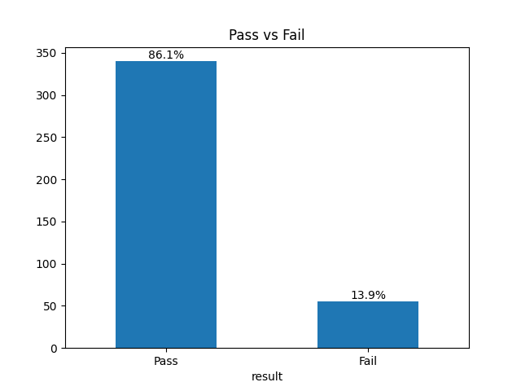
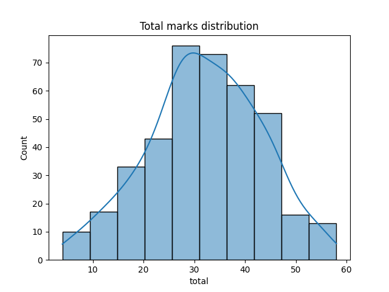
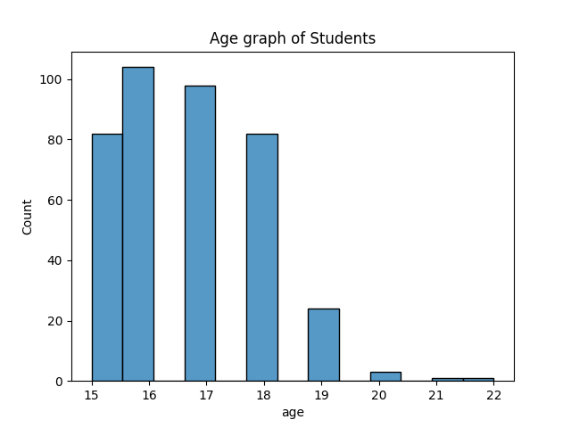
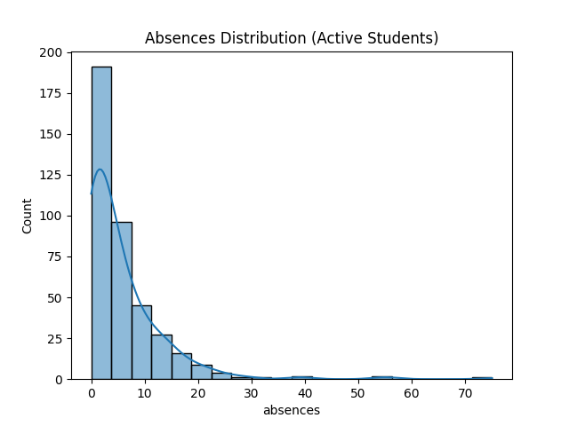
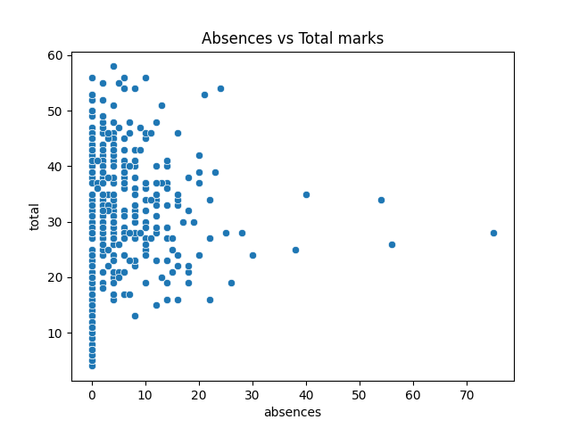
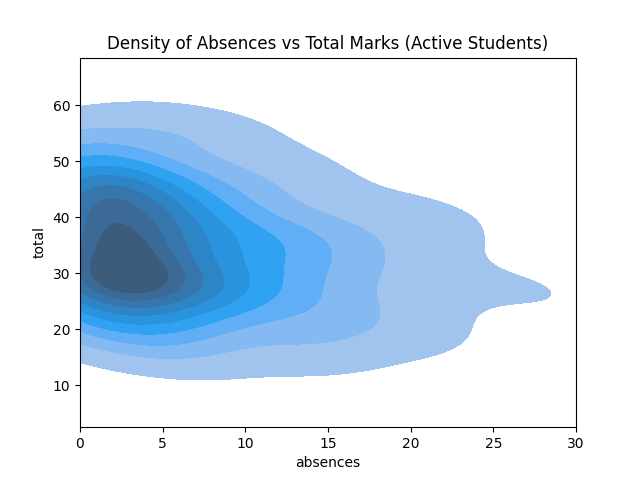

# 📊 Analysis of Student Data — Exploratory Data Analysis & Performance Insights

[](https://www.python.org/)
[](https://pandas.pydata.org/)
[](https://matplotlib.org/)
[](https://seaborn.pydata.org/)
[](https://jupyter.org/)
[](https://github.com/CodeWithAnurup)
[]()

> **Project:** Intern Nova AI & Data Science Internship — Week 2  
> **Milestone:** Task 5 — Comprehensive Student Performance Analysis, Data Cleaning, and Visual Analytics  
> **Author:** [Anurup Samanta](https://github.com/CodeWithAnurup)  
> **Dataset:** Student Performance Dataset (Secondary Education)  

---

## 📌 Executive Summary

Academic performance is influenced by a complex interplay of demographic, behavioural, and lifestyle factors. This project provides an in-depth **Exploratory Data Analysis (EDA)** on secondary school student performance records to identify the critical drivers of student success, dropout/zero-score phenomena, and the correlation between school absences and academic outcomes.

By combining disciplined data hygiene, statistical aggregation, feature engineering (aggregate score synthesis and pass/fail classification), and multi-variate statistical visualizations, this study provides actionable diagnostic insights into student achievement.

---

## 📁 Repository Structure

```text
Analysis-of-Student-Data/
├── .gitignore                                      # Ignored checkpoints and cache files
├── Absesnces_distribution.png                     # Frequency distribution of student absences
├── Densiy_plot_of_Absences_VS_TotalMarks.png       # 2D KDE density plot (Absences vs Total Marks)
├── Notebook.ipynb                                 # Complete end-to-end Jupyter Notebook with executed cells
├── README.md                                      # Project documentation & analytical report
├── absenst_vs_TotalMarks.png                      # Scatter plot: Student Absences vs Total Marks
├── age_graph.png                                  # Age distribution of enrolled students
├── marks_distribution.png                         # Histogram & KDE of aggregate student marks
├── pass_fail.png                                  # Bar plot comparing passing vs failing students
└── student_data.csv                               # Primary dataset containing student attributes & grades
```

---

## 📊 Dataset Architecture & Attribute Overview

The analysis uses student achievement records comprising demographic background, social indicators, study habits, and periodic grades across three assessment periods (**G1**, **G2**, and **G3**):

| Attribute | Data Type | Description |
| :--- | :---: | :--- |
| `school` | `object` | Student's school (`GP` - Gabriel Pereira or `MS` - Mousinho da Silveira) |
| `sex` | `object` | Student gender (`F` - female, `M` - male) |
| `age` | `int64` | Student age (ranging from 15 to 22 years) |
| `studytime` | `int64` | Weekly study time (1: <2 hrs, 2: 2–5 hrs, 3: 5–10 hrs, 4: >10 hrs) |
| `failures` | `int64` | Number of past class failures ($n$ if $1 \le n < 3$, else 4) |
| `higher` | `object` | Wants to pursue higher education (`yes` or `no`) |
| `internet` | `object` | Internet access at home (`yes` or `no`) |
| `health` | `int64` | Current health status (from 1 - very bad to 5 - very good) |
| `absences` | `int64` | Number of school absences (from 0 to 93) |
| `G1`, `G2`, `G3` | `int64` | First, second, and final period grades (0 to 20 scale) |
| `total` | *Engineered* | Aggregate marks across all three periods: $\text{G1} + \text{G2} + \text{G3}$ (Max: 60) |
| `result` | *Engineered* | Pass / Fail outcome based on minimum pass threshold (33% of 60 = 19.8 marks) |

---

## 🛠️ Data Handling & Hygiene Pipeline

1. **Integrity & Null Checks:** Verified zero missing (`NaN`) values across all records using `df.isnull().sum()`.
2. **Deduplication:** Confirmed zero duplicate observations across all feature vectors (`df.duplicated().sum() == 0`).
3. **Feature Selection:** Curated key operational columns (`school`, `sex`, `age`, `studytime`, `nursery`, `higher`, `internet`, `health`, `absences`, `G1`, `G2`, `G3`).
4. **Target Synthesis:**
   - Synthesized `total = G1 + G2 + G3` to represent cumulative student mastery.
   - Categorized students into `Pass` vs `Fail` with a benchmark threshold of $\ge 19.8$ marks.
5. **Dropout / Outlier Analysis:** Discovered and investigated a cluster of 38 students with a final grade of `G3 = 0` (exam dropouts/absentees), separating them during granular absence-trend analyses.

---

## 📈 Key Findings & Insights

- **Overall Pass Rate:** The vast majority of students successfully passed, with passing students significantly outnumbering failures.
- **Score Distribution:** Aggregate scores form an approximately normal distribution centered around **31–32 marks out of 60**, with the highest score recorded at **58** and the lowest at **4**.
- **Student Demographics:** Enrolled ages range between 15 and 22, with peak concentration at **16 and 17 years old**.
- **Absences vs. Academic Outcome:** 
  - Mild to moderate absences (1–10 days) do not sharply degrade performance.
  - However, chronic absenteeism ($>15$ days) introduces high variance, with density plots confirming peak performance concentrated among students with fewer than 10 absences.
  - The zero-grade group (`G3 = 0`) exhibited declining prior term scores (`G1` average of 7.5, `G2` average of 5.9), demonstrating that disengagement precedes final dropout.

---

## 🖼️ Visualizations Gallery

| Pass vs Fail Outcome | Total Marks Distribution |
| :---: | :---: |
|  |  |

| Age Distribution | Absences Distribution |
| :---: | :---: |
|  |  |

| Absences vs Total Marks (Scatter) | Density Plot: Absences vs Marks |
| :---: | :---: |
|  |  |

---

## 🚀 How to Run the Notebook

1. **Clone this repository:**
   ```bash
   git clone https://github.com/CodeWithAnurup/Analysis-of-Student-Data.git
   cd Analysis-of-Student-Data
   ```

2. **Install required packages:**
   ```bash
   pip install pandas numpy matplotlib seaborn jupyter
   ```

3. **Launch Jupyter Lab or Notebook:**
   ```bash
   jupyter lab Notebook.ipynb
   ```

---

## 👤 Author

- **Intern / Developer:** [Anurup Samanta](https://github.com/CodeWithAnurup)
- **Organization:** Intern Nova Internship Program
- **Field:** Artificial Intelligence & Data Science

---
*Created as part of the Intern Nova Data Science Internship — Week 2 Deliverables.*
